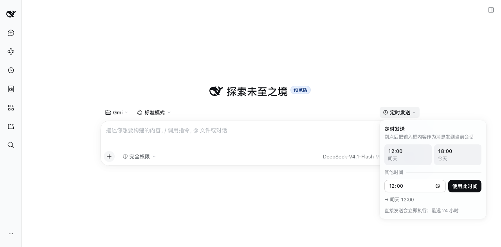
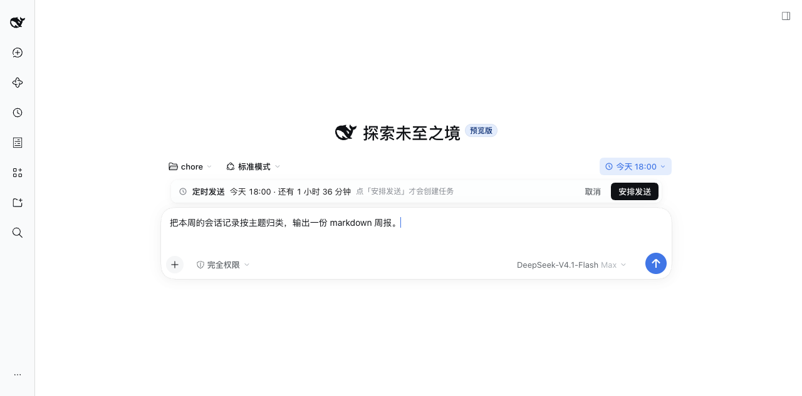

[简体中文](README.md) | **English**

# Schedule send · dsh-schedule-send

Run non-urgent work in DeepSeek's off-peak hours: write it in the composer,
have it start later.

## Why this plugin exists

DeepSeek bills tokens by time of day. On workdays (public holidays excluded),
9:00–12:00 and 14:00–18:00 are peak; the rest is off-peak, at half the peak
price. Most of my work is not urgent and a few hours' delay costs nothing, so
I kept moving execution into the off-peak window.

Telling dsh "run this at 12:00" does not work. It does not wait: that turn
starts reading files, searching, and planning immediately, so the most
token-heavy part still runs at peak and the saving is cut in half. The
reminder is also appended to the current conversation, so whatever was
gathered at registration time is still in context when the time comes.

This plugin keeps the model out of the timing decision. Press **Schedule send**
and the browser calls `create` on the official
[@deepseek-ai/dsh-schedule](https://www.npmjs.com/package/@deepseek-ai/dsh-schedule)
service, registering the draft as a one-shot task:

- Registration: no model call, no tokens.
- At the chosen time: only the text you wrote is delivered, starting from its
  first sentence.
- So the first token is already billed at the off-peak price.

| | "Run this at 12:00" to the model | This plugin |
| --- | --- | --- |
| Registration | One model turn, which usually starts the work | A browser call to the Schedule service; no tokens |
| At the chosen time | Delivered with the whole registration conversation as context | Delivered with only the message you scheduled |
| Saving | Only the wrap-up runs off-peak | Off-peak from the first token |

The longer story, with the price table and the writing recipe, is in the post
[“dsh 延时任务”](https://geodaoyu.github.io/2026/10/19/dsh%20%E5%BB%B6%E6%97%B6%E4%BB%BB%E5%8A%A1/).

## Install

Search `dsh-schedule-send` in **Plugins → Add plugin** in the Web or Desktop
app, or use the CLI:

```bash
dsh plugin --profile web add dsh-schedule-send
```

Refresh the page afterwards. The browser half loads automatically; the Host
half only waits for the `schedule` service and keeps no state of its own.

## Use





1. Write the task in the composer. The scheduled task sends **that text** to the
   model at the chosen time, so write it the way you would write a first
   message: goal, scope, output, constraints.
2. Click **Schedule send** — on the new-session home it sits in the row above
   the composer, after the preset control; inside a conversation it sits in the
   composer tool row after the access-mode control.
3. The panel has a single quick time: the **next off-peak start**.
   - Before 12:00: today at 12:00.
   - After 12:00: today at 18:00.
   - After 18:00: tomorrow at 12:00.

   Pick **Another time** for anything else (up to 24 hours ahead). If you are
   already inside an off-peak window, just press Enter — no scheduled task
   needed.
4. A staging bar appears above the composer. Only its **Schedule** button
   creates the task. The draft then clears and the bar reports the scheduled
   time.
5. At that time the message is delivered and the model starts working. Where it
   lands depends on the composer you scheduled from: an existing conversation
   receives it with its history, while the new-session home starts a fresh
   conversation from that text. Review, pause, or delete the task under
   **Automation tasks** in the sidebar.

## Behaviour and limits

- One-shot `at` tasks only; there are no recurrence rules. Use the Automation
  tasks page or `schedule_create` for recurring work.
- The quick time is simply the nearer of 12:00 and 18:00. It does not know
  about workdays, public holidays, or whether you are already off-peak; if you
  are, just send the message now.
- Times can be at most 24 hours ahead; build longer-range work in Automation
  tasks.
- The delivery target follows the composer: an existing conversation receives
  the message in place, while a task scheduled from the new-session home creates
  its own conversation at delivery (same preset). Several messages scheduled at
  the same moment in one workspace therefore stay in separate conversations.
- Text only: attachments are not scheduled (the bar flags "No attachments"),
  and `/` commands or `@` references travel as plain text instead of running or
  resolving.
- The task title is the first line of the draft, truncated to 60 characters.
- Times are interpreted in the browser's IANA time zone (for example
  `Asia/Shanghai`).
- A picked time is only a staging state: it is kept in this tab's
  sessionStorage, survives a refresh, and is not a task. Pressing the composer's
  own Send runs the draft now and clears it. Created tasks are durable.
- The Host must be running to deliver. An occurrence that comes due while the
  Host is stopped is delivered once on the next start.
- Requires DSH 0.2.2-rc.1 or later with `@deepseek-ai/dsh-schedule` present
  (shipped by `dsh-base` and `dsh-web-app`). Without that service the composer
  control does not appear.

## Uninstall

Remove it in **Plugins**, or:

```bash
dsh plugin --profile web remove dsh-schedule-send
```

Removing the plugin leaves created tasks in place; they still fire under
Automation tasks.

## Development

Plain JavaScript, no build step:

- `index.js` — Host half: `inject = ['schedule']` and no logic.
- `client.js` — the whole UI. It registers through `ctx.slots` into
  `conversation.hero.options`, `conversation.input.left`, and
  `conversation.input.dock`, and creates tasks with
  `ctx.remote.schedule.create()`.
- `locale/*.json` — the title and description shown in the plugin list.
- `cordis.patch.yml` — the bundle patch that inserts the plugin row.

A local-directory install is a symlink, so editing `client.js` and refreshing
the page is enough; changing `package.json` or adding files needs a reinstall
from the Plugins page.

## License

MIT
