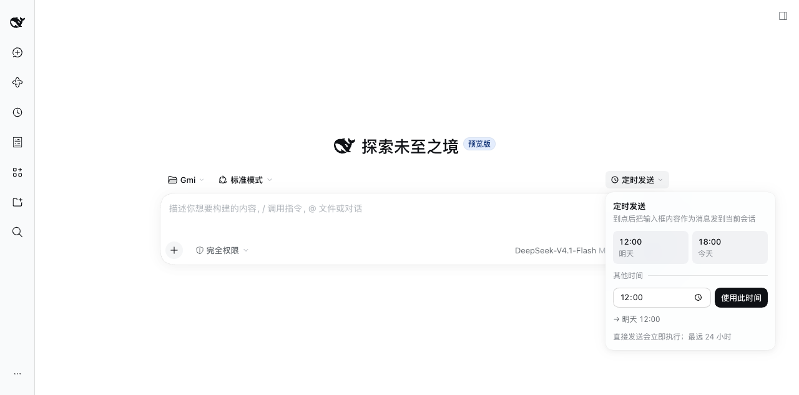
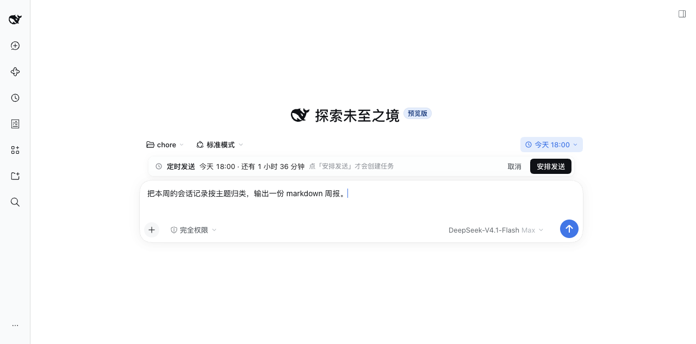

**简体中文** | [English](README.en.md)

# 定时发送 · dsh-schedule-send

把不紧急的活排到 DeepSeek 的谷时再跑：在输入框里写好，到点才执行。

## 为什么做这个插件

DeepSeek 按 token 计费，价格分峰时和谷时。工作日（不含法定节假日）9:00–12:00、14:00–18:00 是峰时，其余是谷时，谷时价格只有峰时的一半。

直接在 dsh 里说「12 点执行某某任务」不行。它不会等到 12 点才动手：那一轮模型当场就开始读文件、查资料、列计划，最花 token 的部分还在峰时跑，省下来的钱打个对折。而且到点提醒是往当前会话追加一条消息，登记那轮查过的东西到点还在上下文里。

这个插件不让模型去理解时间。点「定时发送」，浏览器直接调官方 [@deepseek-ai/dsh-schedule](https://www.npmjs.com/package/@deepseek-ai/dsh-schedule) 的 `create`，把草稿原文登记成一条一次性任务：

- 登记那一轮：0 次模型调用，0 token；
- 到点那一轮：只投递你写的原文，从第一句话开始；
- 于是从第一个 token 起就是谷时价。

| | 跟模型说「12 点执行」 | 这个插件 |
| --- | --- | --- |
| 登记那轮 | 跑一轮模型，常常顺手把活干了 | 浏览器直接调 Schedule 服务，不花 token |
| 到点那轮 | 带着从登记到现在的全部上下文 | 只有投递的那条消息 |
| 省钱效果 | 只有收尾落在谷时 | 从第一个 token 起就是谷时价 |

## 安装

在 Web 或 Desktop 的 **插件 → 添加插件** 里搜索 `dsh-schedule-send` 安装；或用 CLI：

```bash
dsh plugin --profile web add dsh-schedule-send
```

装好后刷新页面。浏览器那一半会自动加载，Host 那一半只等 `schedule` 服务就绪，自己不留状态。

## 用法





1. 在输入框里写好要做的事。定时任务会把**这段原文**在到点时发给模型，所以按「第一次收到这条请求」的口吻写全：目标、范围、产出、约束。
2. 点「定时发送」：
   - 新会话首页：在输入框上方那行，「标准模式」右边；
   - 已有会话：在输入框左下角，「完全权限」后面。
3. 面板里只有一个快捷时间，就是**下一个谷时起点**：
   - 12:00 前是今天 12:00；
   - 12:00 后是今天 18:00；
   - 18:00 后是明天 12:00。

   要别的时刻选「其他时间」（最远 24 小时）。现在已经在谷时的话，直接回车就行，不需要定时任务。
4. 输入框上方出现待安排条，点「安排发送」才会创建任务。草稿清空，提示「已安排在 今天 18:00 发送」。
5. 到点后消息才投递，模型开始干活。投递位置看你是在哪种输入框里安排的：
   - 已有会话：投递到这条会话，接着原来的上下文往下做；
   - 新会话首页：到点新建一条会话，从这段原文开始。

   任务可以在侧边栏的 **自动化任务** 里查看、暂停、删除。已经点过「安排发送」、之后又想改内容的话，也是回到 **自动化任务** 里编辑或追加这条任务的内容文本，不用重新安排一次。
6. 等不到点、想马上跑：打开侧边栏的 **自动化任务**，选中这条任务，点右上角的 **⋯** → **立即执行**，这段原文会立刻投递，和到点执行的方式一样。有两点要留意：
   - 「立即执行」只是现在多跑这一次，不会挪走也不会取消原来的定时，到点它还会照常投递；确认不要那一趟了，就在任务里点暂停或删除。
   - 还没点过「安排发送」的草稿不存在于任务列表里，这种情况直接点输入框的发送键就是立即执行。

## 行为与限制

- 只创建一次性任务（`at`），不提供重复规则；需要每天跑的任务请直接用「自动化任务」页或 `schedule_create`。
- 快捷时间是 12:00 和 18:00 里最近的一个，只是省一次手；它不判断工作日和法定节假日，也不判断当前是不是谷时。现在就在谷时的话，直接发送即可。
- 能选的时间最远 24 小时，更远的日程请在「自动化任务」里建。
- 投递目标：已有会话投递到**当前会话**；新会话首页安排的任务在到点时**新建一条会话**（沿用你选的预设），所以同一个工作区里同时安排的几条消息各自独立，不会因为到点时间相同就挤进同一段对话。
- 只投递文本：草稿里的附件不会随任务发送（待安排条会标出「附件不发送」）；`/` 指令和 `@` 引用会作为纯文本投递，不会执行或展开成文件。
- 任务标题取草稿第一行前 60 个字符，方便在任务列表里认。
- 时间按浏览器所在时区（IANA 名称，例如 `Asia/Shanghai`）解释；换机器或换时区会按当时的浏览器时区计算。
- 选好但还没点「安排发送」的时间只是「待安排」状态，存在当前标签页的 sessionStorage 里，刷新还在，但它不是任务；直接点输入框的发送键会立即执行并清掉这个状态。已经创建的任务是持久的。
- Host 必须开着才会投递；停机期间到期的那次，会在下次启动时补投一次。
- 需要 DSH 0.2.2-rc.1 及以上，且配置里要有 `@deepseek-ai/dsh-schedule`（`dsh-base` / `dsh-web-app` 自带）；没有这个服务时插件不会显示。

## 卸载

在 **插件** 里移除，或：

```bash
dsh plugin --profile web remove dsh-schedule-send
```

卸载不会删除已经创建的任务，它们在「自动化任务」里照常存在。

## 开发

纯 JavaScript，没有构建步骤：

- `index.js`：Host 半边，`inject = ['schedule']`，没有逻辑。
- `client.js`：全部界面。通过 `ctx.slots` 注册到 `conversation.hero.options`、`conversation.input.left` 和 `conversation.input.dock`，用 `ctx.remote.schedule.create()` 建任务。
- `locale/*.json`：插件列表里的标题与说明。
- `cordis.patch.yml`：bundle 的 patch 层，插入 plugin 行。

本地目录安装是软链接，改完 `client.js` 刷新页面即可看到效果（改 `package.json` 或新增文件需要在插件页重新安装）。

## License

MIT
